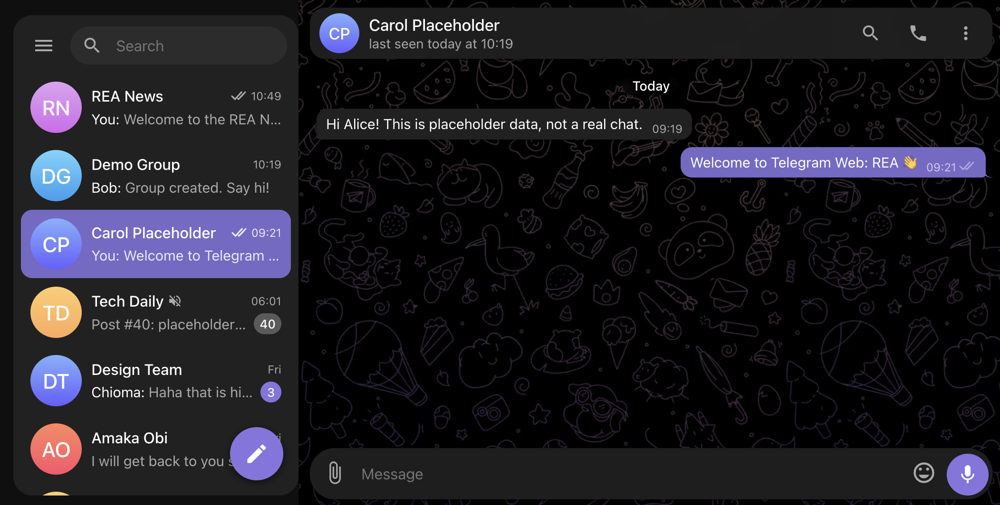

# Telegram Web by coding180

A working Telegram Web-style chat app you can run on your own machine in under a minute. Real-time chat, groups, channels, with no dependencies and no build step.

> Demo project. It is **not** connected to Telegram and is not production ready. 



## Quick start

You need [Node.js](https://nodejs.org) 18 or newer (check with `node -v`).

```bash
git clone <this-repo-url>
cd telegram-web-rea
npm start
```

Open **http://localhost:4530**. To use another port: `PORT=8080 npm start`.

The first start creates a `data/` folder with demo content. To wipe everything and start fresh: `npm run reset`.

## Log in

On the login screen click **Alice** or **Bob**, or enter a phone number:

| Account | Phone |
|---|---|
| Alice | `+15550001` |
| Bob | `+15550002` |

The verification code is always **12345**. Any other number starts a sign-up (code, then a profile name).

**Try two users at once:** open `http://localhost:4530` in one window and `http://127.0.0.1:4530` (or a private window) in another, and log in as a different user in each.

## Features

- **Chat:** real-time messaging, typing indicator, online/last seen, read ticks, unread badges
- **Messages:** reply, edit, delete, forward, copy, pin, emoji reactions, emoji picker, image and file attachments (up to 15 MB), in-chat search
- **Groups:** create with name and photo, add/remove members, owner and admin roles, invite links, leave or delete
- **Channels:** name, description, subscribers; only admins can post
- **Conferences:** simulated group-call screen with invite link (no real audio or video)
- **Also:** Saved Messages, contacts and username search, global search, archive, mute, pin chats
- **Settings:** profile (name, username, bio, avatar), light/dark theme, wallpapers, text size, notifications
- **Responsive:** works on desktop and mobile widths


## Project layout

```
server.mjs      Node server: REST API, real-time events (SSE), JSON-file storage
public/         Front end (plain ES modules, no build)
docs/           README screenshot
data/           Created on first run (database and uploads, git-ignored)
```

## Credits

Developed by **[coding180](https://coding180.com/forum)**, built with the REA (reverse-engineer-anything) tool as a clean-room re-implementation. All names, chats and data in the demo are placeholders.

## More apps and contact

- Join the forum for more reverse-engineered apps and to contact the developer: **https://coding180.com/forum**
# telegram-web-coding180
